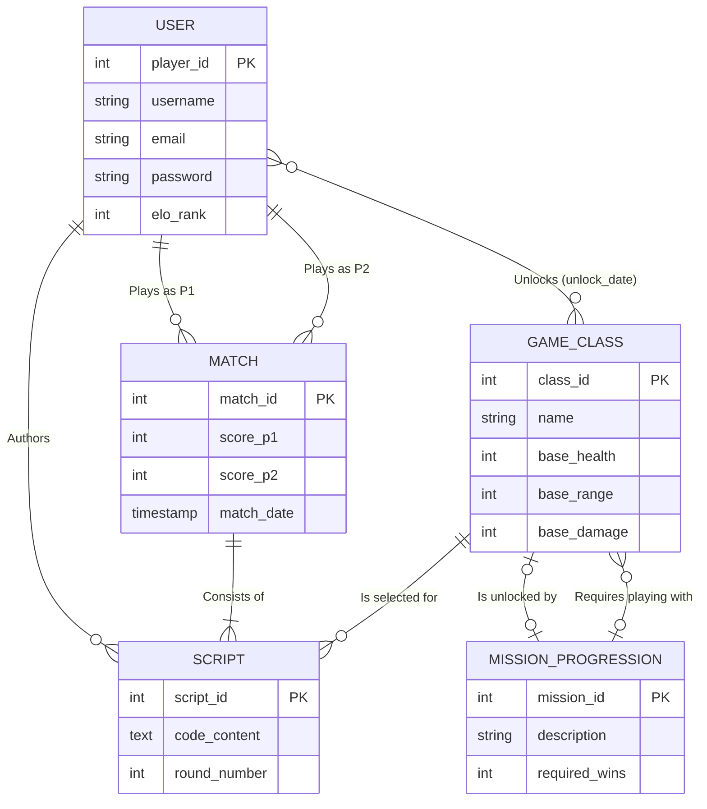

# Modélisation des Données - CodeArena (MCD & MLD)

Ce document décrit la conception de la base de données de CodeArena, comprenant le modèle conceptuel (MCD) et le modèle logique de données relationnel (MLD).

---

## 1. Modèle Conceptuel de Données (MCD)

Le diagramme entité-association ci-dessous décrit les entités du domaine, leurs attributs et leurs cardinalités.

---

## 2. Modèle Logique de Données (MLD Relationnel)

Le schéma relationnel traduit les entités et relations ci-dessus dans PostgreSQL :

1. **USER** (
   <u>player_id</u> SERIAL,
   **username** VARCHAR(50) NOT NULL UNIQUE,
   **email** VARCHAR(255) NOT NULL UNIQUE,
   **password** VARCHAR(255) NOT NULL,
   **elo_rank** INT NOT NULL DEFAULT 1000
)

2. **CLASS** (
   <u>class_id</u> SERIAL,
   **name** VARCHAR(50) NOT NULL,
   **base_health** INT NOT NULL,
   **base_range** INT NOT NULL,
   **base_damage** INT NOT NULL,
   #required_mission_id INT NULL REFERENCES MISSION_PROGRESSION(mission_id) ON DELETE SET NULL
)

3. **MISSION_PROGRESSION** (
   <u>mission_id</u> SERIAL,
   **description** TEXT NOT NULL,
   **required_wins** INT NOT NULL,
   #conditional_class_id INT NULL REFERENCES CLASS(class_id) ON DELETE SET NULL
)

4. **PLAYER_UNLOCK** (
   <u>#player_id</u> INT REFERENCES USER(player_id) ON DELETE CASCADE,
   <u>#unlocked_class_id</u> INT REFERENCES CLASS(class_id) ON DELETE CASCADE,
   **unlock_date** TIMESTAMP NOT NULL DEFAULT CURRENT_TIMESTAMP,
   PRIMARY KEY (player_id, unlocked_class_id)
)

5. **MATCH** (
   <u>match_id</u> SERIAL,
   #player_1_id INT NOT NULL REFERENCES USER(player_id) ON DELETE CASCADE,
   #player_2_id INT NOT NULL REFERENCES USER(player_id) ON DELETE CASCADE,
   **score_p1** INT NOT NULL DEFAULT 0,
   **score_p2** INT NOT NULL DEFAULT 0,
   **match_date** TIMESTAMP NOT NULL DEFAULT CURRENT_TIMESTAMP
)

6. **SCRIPT** (
   <u>script_id</u> SERIAL,
   #match_id INT NOT NULL REFERENCES MATCH(match_id) ON DELETE CASCADE,
   #player_id INT NOT NULL REFERENCES USER(player_id) ON DELETE CASCADE,
   #class_id INT NOT NULL REFERENCES CLASS(class_id) ON DELETE CASCADE,
   **code_content** TEXT NOT NULL,
   **round_number** INT NOT NULL CHECK (round_number > 0)
)

---

## 3. Gestion des dépendances circulaires

Une dépendance réflexive existe entre `CLASS` et `MISSION_PROGRESSION` :
- Une classe peut nécessiter la complétion d'une mission pour être débloquée (`class.required_mission_id`).
- Une mission peut exiger de jouer avec une classe spécifique (`mission_progression.conditional_class_id`).

Pour éviter tout blocage à la création, la table `CLASS` est d'abord instanciée, puis `MISSION_PROGRESSION`, et la contrainte de clé étrangère `fk_class_mission` est ajoutée dynamiquement par un bloc `ALTER TABLE` sécurisé dans `backend/db/init.sql`.
